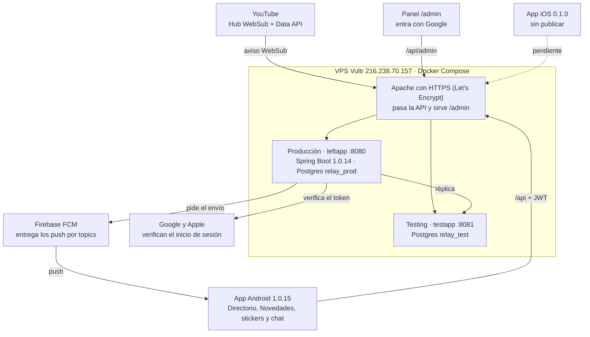

[← Inicio](README.md)

# Arquitectura

YouTube avisa al servidor y el servidor avisa a los teléfonos.

Un video nuevo sigue este camino: YouTube avisa por WebSub a `/websub`, el servidor de producción pide los datos a la Data API (1 unidad), lo guarda en Postgres y pide a FCM un solo envío para todos los topics de quienes siguen a ese creador, medio o canal. El teléfono abre la ficha del video y de ahí YouTube.

Fuera del VPS quedan GitHub (código, imágenes en GHCR y respaldo `datos/`) y el sitio legal `vocesdeizquierda.com`. Las carpetas `functions/` y `firestore.rules` son del diseño anterior con Firebase y ya no se despliegan.
