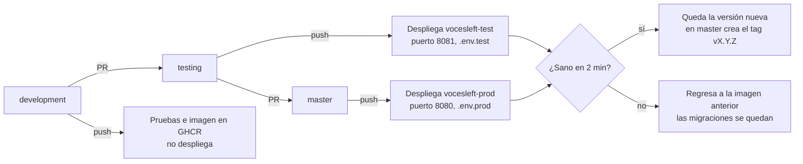

[← Inicio](README.md)

# Flujo de ramas y pipeline CI/CD

El código sube siempre en el mismo orden: se trabaja en `development`, se fusiona a `testing` por pull request para probar en el servidor y, cuando está sano, se fusiona a `master`. El workflow es `.github/workflows/pipeline.yml` («VocesLeft CI/CD») y solo se dispara con cambios en `relay-server/**`, `scripts/deploy-vps.sh`, `Makefile` o el propio workflow.

Una imagen que no queda sana en dos minutos se reemplaza por la anterior; las migraciones no se revierten, por eso deben ser compatibles con la versión previa.

| Evento | Resultado |
| --- | --- |
| Pull request a `development`, `testing` o `master` | Pruebas Java y construcción de la imagen, sin publicar ni desplegar |
| Push a `development` | Pruebas e imagen publicada en GHCR; no despliega |
| Push a `testing` | Despliega `vocesleft-test` con `.env.test` |
| Push a `master` | Despliega `vocesleft-prod` con `.env.prod`; si la versión es nueva, etiqueta la imagen `:X.Y.Z` y crea el tag `vX.Y.Z` |
| Ejecución manual | `none` (solo validar) o `test` desde cualquier rama; `prod` solo desde `master` |

**Pasos del workflow:** probar con Java 21 (Temurin) → copiar las imágenes base de ECR Public a `ghcr.io/ddsr1809/vocesleft-base` (evita el límite de descargas) → construir y publicar `ghcr.io/ddsr1809/vocesleft-relay:<sha>` con el commit en `SERVIDOR_COMMIT` → desplegar por SSH con `scripts/deploy-vps.sh`, que solo recrea el contenedor `servidor` y conserva Postgres.

## Reglas que conviene recordar

- Para publicar otra versión hay que subir `version` en `relay-server/build.gradle.kts`; un push a `master` con la misma versión despliega pero no crea tag.
- El panel (`admin/`) y el sitio (`web/`) no los despliega el pipeline: van con `git pull` en el VPS.
- `master` recibe commits del respaldo `datos/` que no están en `development`; por eso no se empuja directo a `master` desde la laptop.
- La app Android no pasa por el pipeline: se compila y sube a Play a mano.
- Cambios solo en `docs/` no disparan el pipeline.

El detalle completo está en [`PIPELINE.md`](../../PIPELINE.md).
